# creditbridge-ai

[](https://github.com/revathyh95-harichandran/creditbridge-ai/actions/workflows/tests.yml)

Credit risk analytics on the [Home Credit Default Risk](https://www.kaggle.com/competitions/home-credit-default-risk)
dataset (307,511 loan applications), from a business question to a deployed decision tool.

**In one line:** a leak-free scikit-learn pipeline and a cost-based cut-off make the lender's
approve/decline decision **15% cheaper than approving everyone** on an untouched test set
(saving 62 per 1,000 applicants, 95% range 55–69), with an explainable logistic regression
that is within half a point of a gradient-boosting black box.

| | |
|---|---|
| **Data engineering** | DuckDB + SQL pipeline, data-quality audit, Power BI dashboard |
| **Machine learning** | leak-free preprocessing inside cross-validation, fair 5-fold model comparison, lasso feature selection, scorecard with odds ratios, decision trees, LDA, SVM, k-means |
| **Decision science** | error costs, cost-based cut-off, one-time test with bootstrap uncertainty, fairness check |
| **Engineering** | 98 pytest tests on made-up data, GitHub Actions CI, ruff, a Streamlit app |

Non-technical? Start with [reports/analyst_summary.md](reports/analyst_summary.md), a
one-page summary with no code or jargon.

The project has two parts:
- **Part 1: should we approve this loan?** A full approve/decline model for every applicant,
  judged in money, not accuracy.
- **Part 2: the thin-file question.** Can we score people with almost no credit history?
  (The project's original question, now re-run on the leak-free pipeline.)

---

# Part 1 · Should we approve this loan?

## The decision and what a mistake costs

A lender gets an application and has to approve or decline it. The model gives each
applicant a **probability of default**, and the lender declines everyone above a cut-off.
Two mistakes are possible, and they don't cost the same:

| | Applicant repays | Applicant defaults |
|---|---|---|
| **Approve** | fine (cost 0) | **missed defaulter**: lose part of the loan (cost **5**) |
| **Decline** | **turned away a good customer**: lose the profit (cost **1**) | fine (cost 0) |

5 : 1 is an assumption (the textbook German Credit cost matrix uses the same ratio), so
every result is also checked at **3 : 1 and 10 : 1**. Without a model, the cheapest policy
is to approve everyone: **404 per 1,000 applicants** at 5 : 1. That's the number to beat.

**Success criteria, written down before any model existed:**
1. cheaper than approving everyone, in every CV fold and at 3, 5 and 10 : 1
2. ROC-AUC ≥ 0.70
3. explainable: a black box only wins if it's at least 0.01 AUC better
4. stable: fold-to-fold spread of AUC ≤ 0.01
5. a fairness check by gender (which is never a model input)

All five were met (details below).

## A leak-free pipeline (and the leak I fixed)

In the first version of this project I cleaned the data in DuckDB *before* splitting it
into training and test rows. So the medians used to fill blanks and the 1st/99th
percentiles used to cap outliers were computed on **all** rows, including the test rows.
That's a classic leak: the test set quietly shapes the training data.

Now every model goes through one scikit-learn pipeline (`src/pipeline.py`) that is
**refitted inside every cross-validation fold**, so anything it learns comes from that
fold's training rows only:

```
raw row -> fixed rules (365243 code, days -> years, ratios)   learns nothing
        -> drop columns (>50% blank, near-constant, |r|>0.95)  learns which columns
        -> cap outliers at 0.1/99.9 percentiles                learns the caps
        -> log of skewed columns                               learns which columns
        -> impute + "was missing" flags                        learns medians/models
        -> scale + one-hot encode                              learns means, categories
        -> model
```

A test (`tests/test_pipeline.py`) checks that a value appearing only in the test rows
can't move a learned cap or median. Re-running the original thin-file model this way gave
**the same test AUC (0.685)**, so the leak was real but hadn't inflated the result.
`src/clean.py` still feeds the descriptive work (segments, dashboard), where a split
doesn't apply.

**Which preparation choices actually mattered?** Each one was compared on the same 5 folds
(`src/prep_experiments.py`):

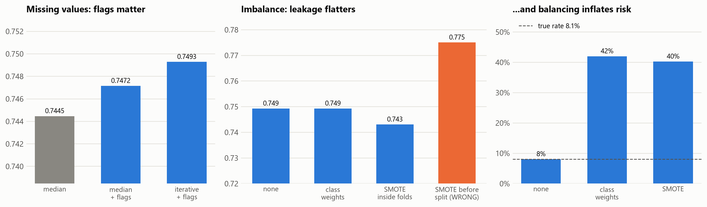

- **A blank is a signal.** Filling blanks with the median *without* "was missing" flags is
  worse in all 5 folds. Missing external scores mean higher risk, missing occupation means
  lower risk (mostly pensioners), and the flags keep that.
- **Balancing the classes (8% default) didn't help ranking.** Class weights give the same
  AUC but push the average predicted risk from an honest 8% to 42%. SMOTE done properly is
  slightly worse. **SMOTE done before the split looks best (0.775), but that's leakage**:
  synthetic copies of validation applicants' neighbours end up in training. I handle the
  imbalance with a cost-based cut-off instead, which keeps the probabilities honest.
- Capping, log transforms and the column-drop rules barely change the score for logistic
  regression; they stay for robustness (the app accepts typed-in values).

## Fair model comparison

Same preparation, same 5 stratified folds, same measures for every model
(`src/compare_models.py`):

| Model | ROC-AUC (5-fold) | Fold sd | Lowest cost / 1,000 |
|---|---|---|---|
| Gradient boosting (black-box reference) | 0.754 | 0.002 | 342 |
| **Logistic regression** | **0.749** | 0.003 | **345** |
| Linear SVM (Platt-scaled) | 0.749 | 0.003 | 345 |
| LDA | 0.748 | 0.003 | 346 |
| Decision tree (depth 6) | 0.714 | 0.003 | 365 |

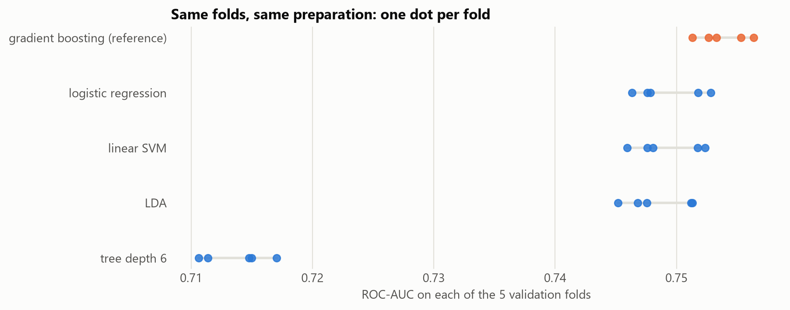

Gradient boosting ranks best, but only by **+0.0045**, below the 0.01 bar from criterion 3.
So the **explainable logistic regression is the final model**, decided by the rule before
the test set was opened. The three linear models agree almost exactly.

**Trees and overfitting:** the training score keeps climbing with depth, while the
validation score peaks around depth 6–8 and then falls. Depth 6 is chosen (same score as 8,
simpler).

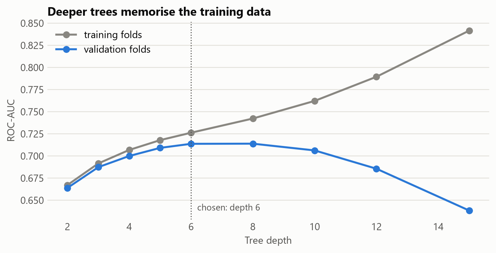

## A scorecard you can read

The full model uses ~150 prepared columns, and its weights are hard to read one by one
because inputs move together (credit amount and annuity correlate at 0.85). So I used a
lasso (L1) path inside the same folds to find the smallest useful set of fields, with a
limit of 10 (a form a loan officer can fill in in a minute), and refitted those as a plain
logistic regression (`src/scorecard.py`).

**Five fields reach ROC-AUC 0.733**: the three external credit scores, the loan-to-goods
ratio and years employed. Each odds ratio is the change in the odds of default for one
standard deviation more:

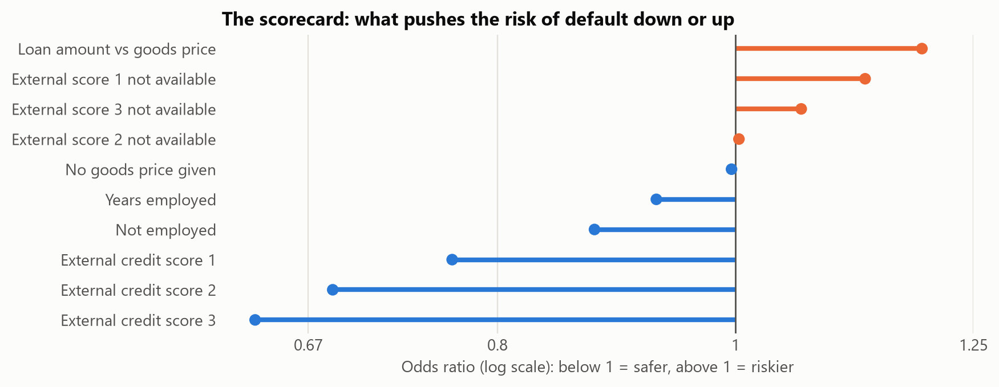

`scorecard.reasons()` turns this into the **main reasons behind any single decision**
(each input's weight × its standardised value, which adds up exactly to the model's
log-odds). The app shows them for every applicant.

## The cut-off, and why accuracy points the wrong way

The cut-off is chosen on **out-of-fold** training predictions (each made by a model that
never saw that applicant), never on the test set. Theory says that with honest
probabilities you should decline when p × 5 > (1 − p), i.e. **p > 1/6 ≈ 0.17**. The data
says **0.16**.

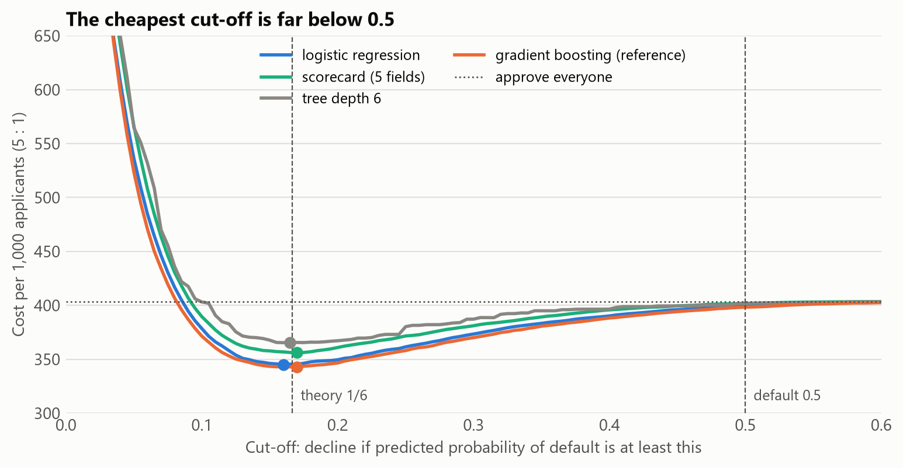


At the default cut-off of 0.5 the model is **92% accurate and almost useless** (it declines
0.2% of applicants). At 0.16 accuracy *drops* to 86%, but it stops 30 defaulters per 1,000
at the price of turning away 94 good customers, and at 5 : 1 that trade pays off: the cost
falls by 14.5%. **The best decision has the lowest accuracy.**

## The test set, used once

The 61,503 test applicants were split off before any exploration and scored once
(`src/evaluate.py`), after the final model and cut-off were fixed:

| | Result |
|---|---|
| ROC-AUC | **0.751** (cross-validation said 0.749) |
| Cost per 1,000 at cut-off 0.16 | **341.6** vs 403.6 for approving everyone |
| Saving | **62 per 1,000 (−15.4%)**, 95% bootstrap range **55–69** |
| At 3 : 1 / 10 : 1 | −6.5% / −32.3% |

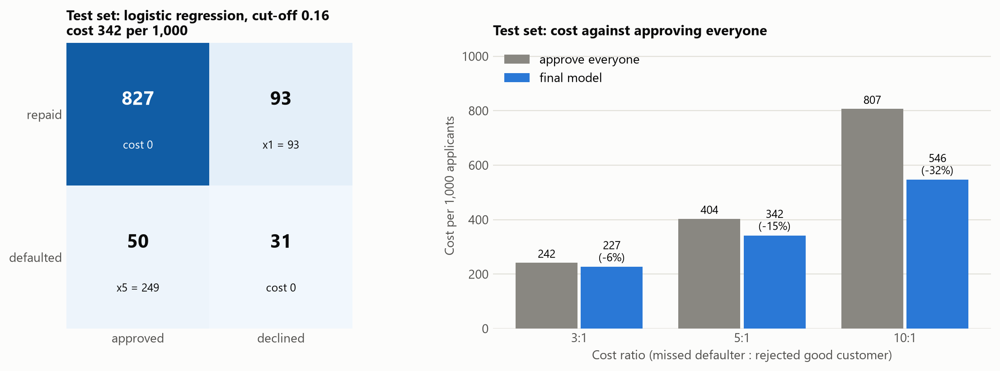

Every model's test score landed within 0.004 of its cross-validation score, so the
evaluation was honest:

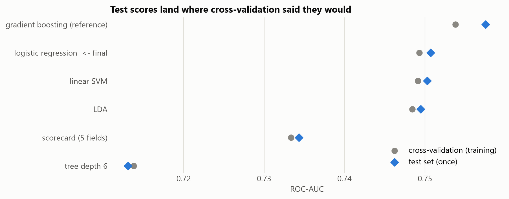

**Fairness:** gender is never an input, but other inputs can carry it. At the 0.16 cut-off,
women are approved more often than men (90% vs 83%), which mirrors their real default
rates (7.0% vs 10.2%). Among those approved, men still default more (6.8% vs 5.2%), so the
model isn't stricter on men than their actual risk; the approval-rate ratio is 0.93 (above
the common 0.8 warning line). It's a check, not proof: a real lender would need a proper
fairness and legal review.

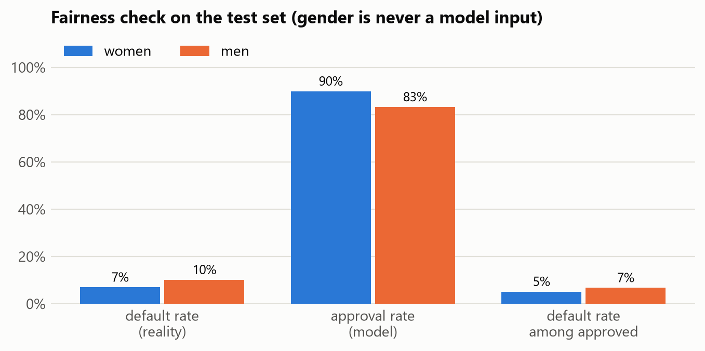

## Applicant segments (unsupervised)

k-means on 13 profile fields, **without** the default label, the external scores or gender
(`src/clusters.py`). Four stable segments (the same grouping across random seeds, ARI 1.0):

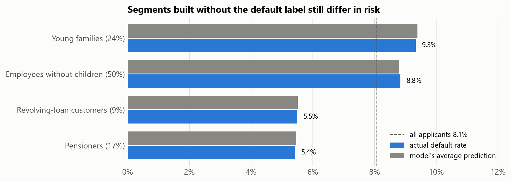

The segments differ clearly in risk even though the label was never used to build them,
and the model's average prediction matches every segment's real default rate within 0.1
percentage points. The silhouette is low (0.17), so they're stable summaries of a
continuum rather than sharply separate types. They're useful for products and monitoring;
the approve/decline decision stays with the scorecard.

## The app

```bash
streamlit run app/app.py
```

Three tabs: **cut-off and costs** (move the cut-off and watch the confusion matrix and cost
update), **score an applicant** (the 5-field scorecard with its main reasons) and
**segments**. It runs locally after the modelling scripts, because it needs the Kaggle data
and the fitted models, which are never put on GitHub.

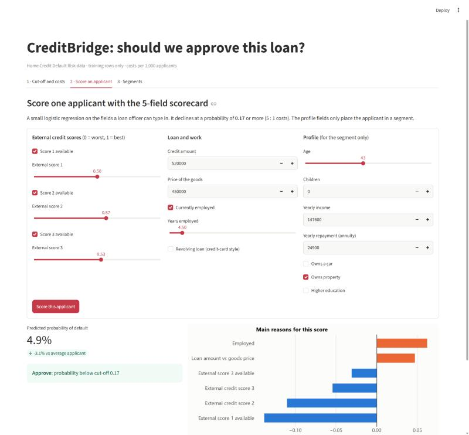

---

# Part 2 · The thin-file question


Traditional scorecards lean on bureau depth and external scores. Applicants without them are
often declined by default, not because they are risky but because they are *unmeasured*.
This project starts by isolating that population and asking whether its default behaviour
actually differs from the well-documented ("thick-file") majority.

**Segment definition** (`src/segment.py`):

| Segment | Rule |
|---|---|
| `thin-file` | 0 or 1 records in `bureau.csv` **AND** at least one of `EXT_SOURCE_1/2/3` missing |
| `thick-file` | everything else |

## Dashboard Insights — What I Found

Notes on what the dashboard (`dashboards/credit_risk_dashboard.pbix`) actually shows,
written in plain terms so it still makes sense on a re-read months from now.

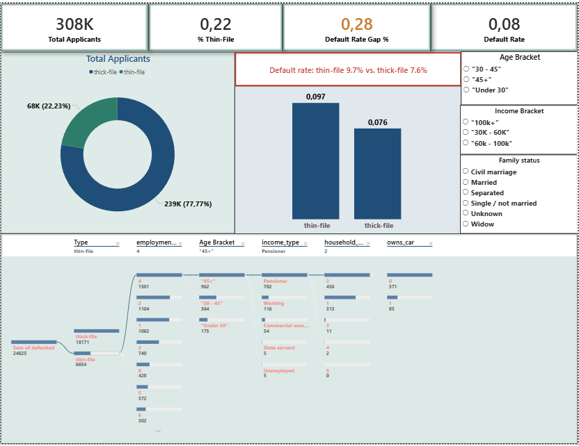

**What's on it:**

- **Top row:** total applicants (308K), the share who are thin-file (22%), how much more
  often thin-file people default (0.28 = 28% more), and the overall default rate (8%).
  Power BI writes decimals with a comma, so 0,22 just means 0.22.
- **Donut:** the split, 68K thin-file vs 239K thick-file.
- **Bar chart:** the default rate, 9.7% for thin-file vs 7.6% for thick-file.
- **Filters on the right:** age bracket, income bracket and family status. Click one and
  every chart on the page updates to just that group.
- **Decomposition tree (bottom):** starts from all 24,825 people who defaulted and lets you
  click down one level at a time: file type → years employed → age → income type →
  household size → owns a car. The path in the picture follows thin-file defaulters with
  about 4 years in their job, aged 45+, who are pensioners in two-person households.

Every number on it was checked against the cleaned data. (The `.pbix` file itself isn't
on GitHub because it stores a full copy of the Kaggle data inside it, which the
competition rules don't allow sharing. The screenshot only shows totals and percentages.)

**What the numbers say:**

- Out of 308K applicants, 68K (22%) are "thin-file" — basically, people we don't have
  much credit history on. That's not a small group, it's more than 1 in 5 applicants.
- These thin-file people do default more often — 9.7% of the time vs 7.6% for everyone
  else. That's a real difference, but it's not huge. It's not like thin-file people are
  twice as risky or something — they're a bit riskier, not a lot.
- When I dug into the dashboard a bit more, the usual stuff still applies here too —
  people who've had their job longer, and people who are a bit older (45+), default
  less. Same pattern you'd expect for anyone, thin-file or not. So it's not like these
  people are some weird unpredictable group — the normal signals still work on them.
- Here's the interesting part: even though we don't have much bureau/credit history on
  these people, we DO have basically everything else — their income, what kind of job
  they have, family details, whether they own a car or house, and whether they've
  borrowed from us before (93.5% of them have!). So it's not that we know nothing about
  them, we just don't have the one specific thing (credit history).

**What I'd actually suggest doing:**

1. Don't auto-reject people just because they're thin-file. We have enough other info
   on them to make a real decision instead of guessing.
2. If we want to test this out, start with the safer-looking thin-file people first —
   longer job history, 45+, already applied with us before. These already look closer
   to the "safe" group in the numbers.
3. Whatever we try, actually check afterward if it worked — compare the real default
   rate of whoever we approve against that 9.7% number, to make sure we're not just
   letting in more risk than we think.

## Model — Can We Score Thin-File People Without Credit History?

*Re-run in November 2026 on the leak-free version: rows are read raw, and capping, filling
and scaling are learned inside the model pipeline on training rows only. The headline AUC
(0.685) and the "safest half defaults at 5.2%" result didn't change; a few smaller
numbers moved slightly and are updated below.*

The dashboard showed we have loads of info on thin-file people, just not their credit
history. So the obvious next question was: is that info actually enough to tell the
safe ones from the risky ones? I built a model to find out (`src/model_thin_file.py`).

**What I used:** only stuff people tell us when they apply, plus what we already know
from them borrowing with us before. That's loan size, income, job type, education, age,
how long they've worked, whether they own a car or house, family size, and their past
applications with us. No credit bureau data and no outside credit scores. I also left out
gender and marital status, because using those to decide loans is illegal in a lot of
countries.

**How I tested it:** I trained it on 75% of thin-file people, then tested it on the other
25%, which the model had never seen. I tried a simple model (logistic regression) and a
fancier one (gradient boosting). They scored basically the same, so I kept the simple
one, because it's easier to explain.

**What it found:**

The really useful bit: if the bank only approved the **safest half** of thin-file people
(according to the model), their default rate would be **5.2% instead of 9.7%**. That's
actually lower than the 7.6% **average** for normal thick-file customers! And the
**riskiest 10%** default at about **23%**, so it's also good at spotting who to be
careful with.

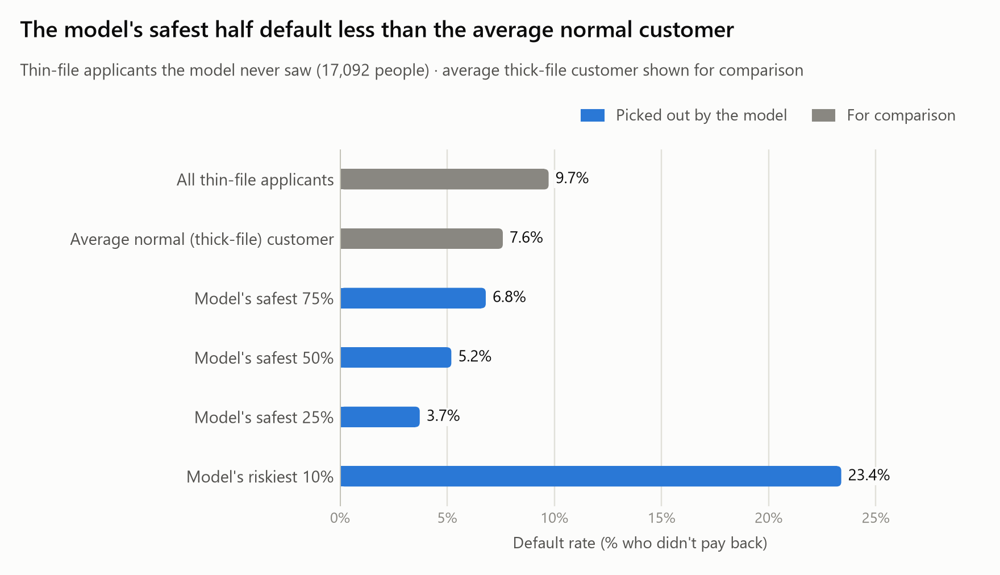

**How to read it:** grey bars are the comparisons (all thin-file people, and the average
normal customer). Blue bars are groups the model picked out from people it had never
seen. Shorter is better for the "safest" bars, and the "riskiest 10%" bar should be long,
which means the model really did find the risky people. **Why this chart:** it turns the
model into the one question a bank actually cares about: "if we used this, how many of
the people we approve would fail to pay back?"

What mattered most:

- **Loan size vs price of the thing being bought.** Loans much bigger than the price
  default about twice as often (14% vs 7–8%).
- **Income type.** Pensioners default way less than people with a regular job (6% vs 12%).
- **Education.** People with a degree: 6% vs 11% for secondary school only.
- **Region.** People in the best-rated regions: 6%, worst-rated: 14%.

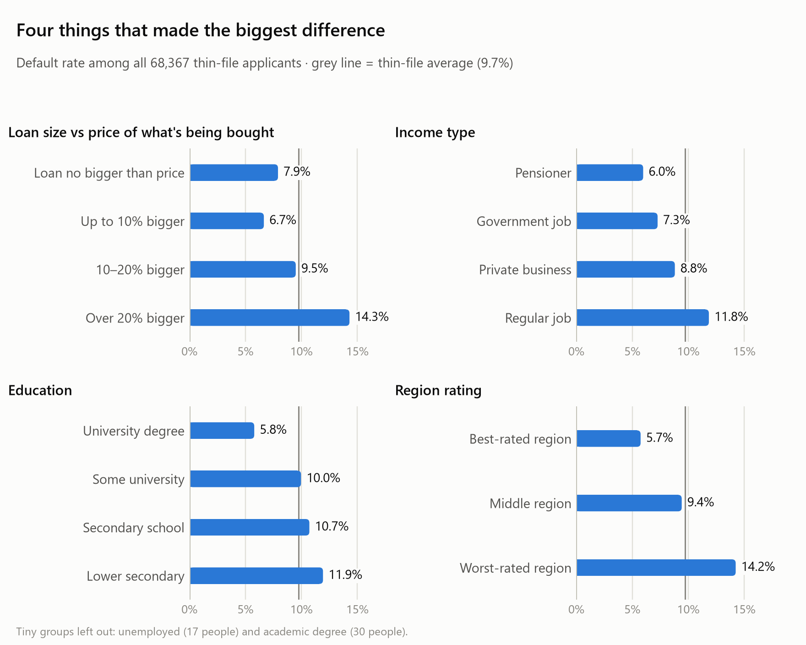

**How to read it:** each panel is one thing the model uses. Each bar is the default rate
for that group, and the grey line is the 9.7% thin-file average. So bars past the line
are riskier than average, and bars short of it are safer. **Why this chart:** a model is
much easier to trust (and to explain to a bank) when you can see *what* it's reacting
to, and that the direction makes sense. Bigger loans for the same item being riskier is
exactly what you'd expect.

And thin-file people aren't harder to score than anyone else. The model scores 0.685
(this is called AUC: 0.5 means coin-flip guessing, 1.0 means perfect), so it's clearly
picking up real patterns. The same model on thick-file people, using the same info,
scored about the same (0.678). Adding credit scores bumps it up to 0.752. So credit
history does help, but not having it doesn't leave you blind. (There's a chart for this
comparison in the next section.)

**What this means:** the "don't auto-reject thin-file people" idea from the dashboard
holds up. Using only info the bank already has, it could approve about half of
thin-file applicants at a *lower* risk than its normal customers.

**Things to keep in mind:**
- This is one dataset from one lender, tested once. A real bank would need to test it
  on newer applicants before trusting it.
- Age is still in the model. That's normally allowed in credit scoring, but a real
  version would need a fairness check to make sure it isn't treating older or younger
  people unfairly.

The charts are drawn by `src/make_charts.py` straight from the data and the model, so
re-running it keeps them up to date.

## How Good Is the Model, Really?

One score isn't enough to trust a model, so I checked it lots of different ways. Every
number here comes from `src/validate_model.py` (same setup as the model: thin-file only,
logistic regression, 75/25 split, random_state=42) and every chart from
`src/make_charts.py`. On every chart, **blue = the model** and **grey = random /
baseline / comparison**. The test set is **17,092 people the model never saw, and 1,664
of them defaulted (9.74%)**.

### Quick scorecard

| Check | What I looked at | Result | Verdict |
|---|---|---|---|
| Overfitting | Train AUC vs test AUC | 0.700 vs 0.685 | ✅ Pass, only a small drop |
| Stability | 5 different random splits + 1,000 bootstrap resamples | 0.683–0.692, range 0.671–0.698 | ✅ Pass |
| Leakage | Previous applications all decided *before* this one? | Latest decision: 1 day before | ✅ Pass |
| Beats simple rules | 3-factor rule (income type, education, region) | 0.613 vs our 0.685 | ✅ Pass |
| Trustworthy % scores | Predicted vs actual per risk group | Brier 0.0840 vs 0.0879 | ✅ Pass (a bit too pessimistic for the riskiest group) |
| Works for all groups | AUC inside each group | 0.621 (pensioners) to 0.705 | ⚠️ Watch out: weaker for pensioners and 45+ |
| Fairness | Approval rates by age and gender | 25.7% (under 30) to 66.6% (45+) | ⚠️ Watch out: needs a legal/fairness review |

### Which metric is the main one, and why

**The main metric is AUC = 0.685**, which banks would quote as **Gini = 0.37** (the same
thing in their units).

**It was picked *before* looking at the results.** The model script already used AUC to
choose between logistic regression and gradient boosting, before any of these checks
existed. That matters, because with 10+ metrics it's tempting to look at all of them and
then shout about whichever one makes the model look best. Picking first keeps it honest.

**Why AUC fits this model:**
- **It matches the question.** The question is "can we *sort* safe people from risky
  ones?", and AUC measures exactly that.
- **It doesn't need a cut-off,** and the bank hasn't decided on one yet.
- **It isn't fooled by only ~10% of people defaulting,** unlike accuracy (see the
  accuracy trap below).
- **Random guessing always scores 0.5, whatever the default rate.** So we can fairly
  compare thin-file (0.685) with thick-file (0.678 / 0.752). PR-AUC can't do that,
  because its random baseline moves with the default rate (0.097 for thin-file vs about
  0.076 for thick-file). That's why PR-AUC is a supporting number, not the main one.
- **Banks already use it,** as Gini.

**One main metric plus two supporting ones:**

| Role | Metric | Result | What it tells you |
|---|---|---|---|
| **Main** | AUC / Gini | 0.685 / 0.37 | How well it sorts safe people from risky ones |
| Business meaning | Default rate of the approved group | Safest 50%: 5.2% vs 9.7% for everyone | What it means in real life |
| Trust check | Calibration (predicted vs actual per risk group) | Dots hug the diagonal; Brier 0.0840 vs 0.0879 | Whether the % scores themselves can be believed |

**When AUC would stop being the main metric:**
- **If the bank picks a fixed cut-off** (e.g. "approve the safest 60%"), the main number
  becomes the default rate *at that cut-off*. Then it's no longer about sorting in
  general, only about where the line falls.
- **If the bank uses the score to set interest rates,** calibration becomes the most
  important check, because the % itself sets the price.

### The accuracy trap (why I don't use accuracy)

Only about 1 in 10 people default. So a "lazy" model that just says *nobody will
default* is right **90.26%** of the time, without learning anything. Our model at the
usual 0.5 cut-off scores **90.28%**, basically the same, because it only flags **17
people**. So accuracy makes a useless model and a useful one look identical. That's why
everything below uses checks that look at how well the model *sorts* people, not how
often it's "right".

### Riskier groups really do default more

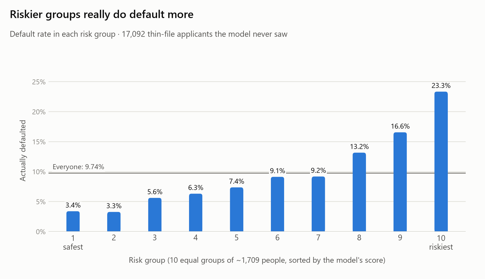

**What it shows:** I sorted the test set by the model's score and cut it into 10 equal
groups of about 1,709 people, safest to riskiest. Each bar is how many in that group
actually defaulted.

**How to read it:** good looks like a staircase going up, with every step higher than
the last. Ours goes from 3.4% in the safest group to 23.4% in the riskiest, about 7
times higher. The grey line is the 9.74% average.

**Why this check:** it's the simplest possible proof that the score means something. You
can see it with your own eyes, no maths needed. **Why not just one number?** One number
like AUC tells you it works *on average*. The staircase shows *where* it works: whether
it separates people at the top and the bottom, not just in the middle.

### Hunting for defaulters (gains chart)

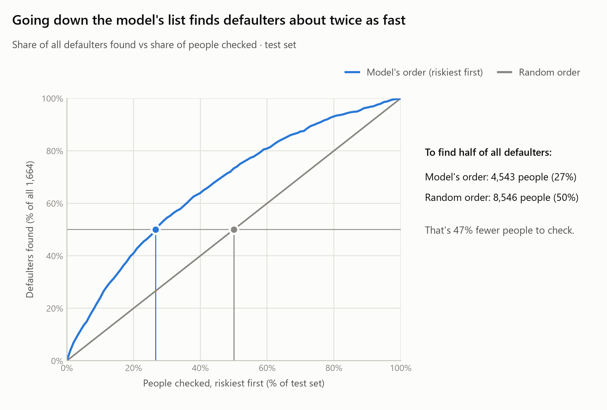

**What it shows:** imagine checking people one by one, riskiest first. The blue line is
how many of all defaulters you've found as you go. The grey line is checking in random
order.

**How to read it:** the higher the blue line sits above the grey one, the better. To find
half of all defaulters, the model's order means checking **4,543 people**. Random order
needs **8,546**, so that's 47% fewer people to check. (8,546 is what random order gives
*on average*. One actual random shuffle can land a few hundred either side.)

**Why this check:** it's how a bank would actually *use* the model: work down a list.
**Why not just one number?** One number hides the shape. The gains chart answers
practical questions straight off the chart, like "if we can only review 20% of people,
how many defaulters do we catch?"

### Hit rate down the list (PR curve and PR-AUC)

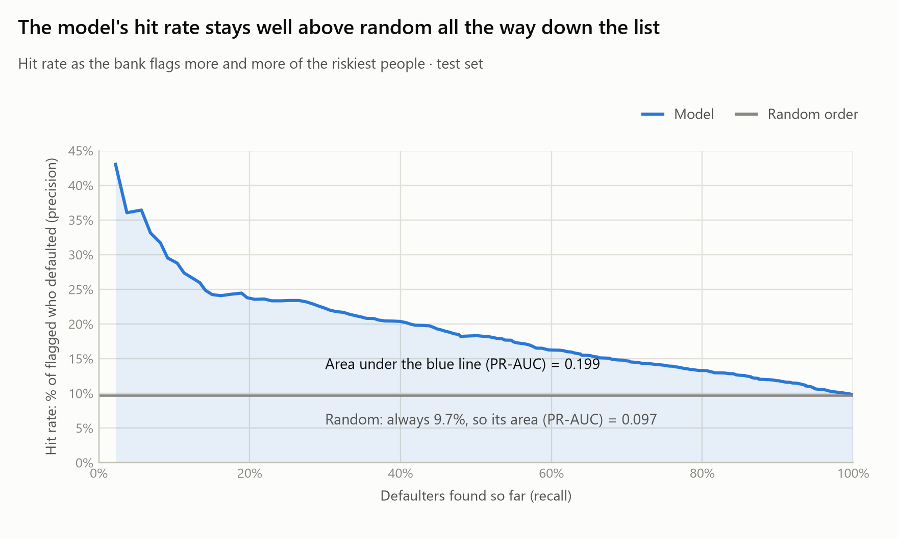

**What it shows:** the same "hunting" idea, but asking "of the people I've flagged so far,
what share really defaulted?" That's the **hit rate** (precision), shown against how
many defaulters you've found (recall).

**How to read it:** the blue line should stay above the grey line. It starts at around
40% for the very riskiest people and slowly drops towards 9.7% as you flag everyone. The
area under the blue line is the **PR-AUC = 0.199**.

**Why its random baseline is 0.097, not 0.5:** if you flag people at random, your hit
rate is just the default rate, 9.7%, however many you flag. So random scores
0.097 here, and "0.199" means **about twice the hit rate of guessing**. This is why
PR-AUC can't be compared across groups with different default rates. Random would score
about 0.076 for thick-file, for example.

**Why this check:** when the thing you're hunting is rare (only 1 in 10), PR-AUC focuses
on the defaulters you're actually trying to find. **Why not accuracy?** See the accuracy
trap above.

### The ROC curve, AUC, Gini and KS

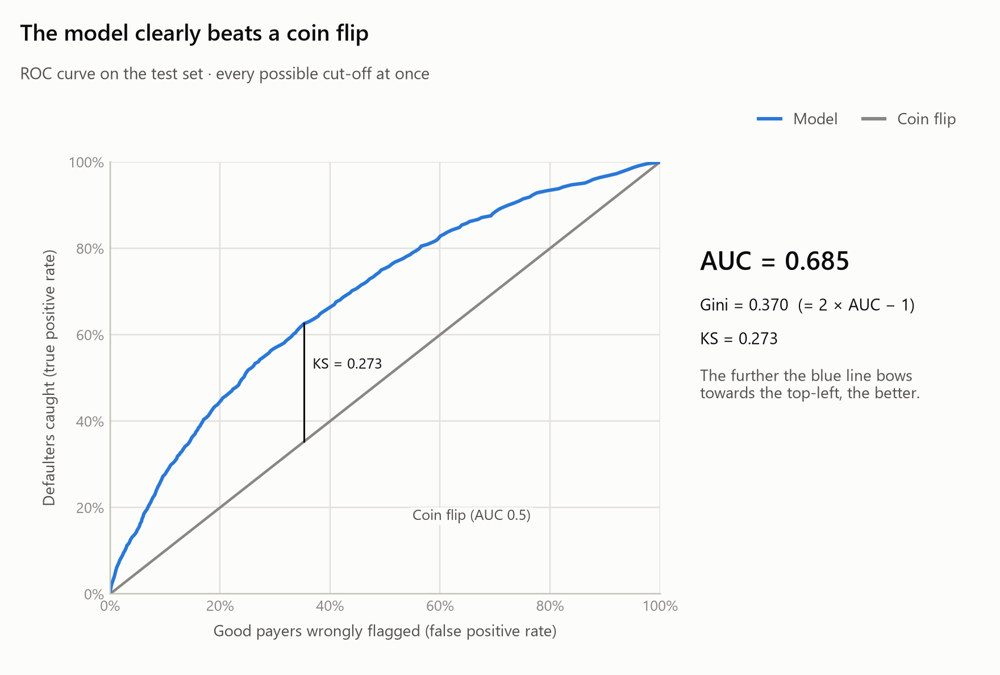

**What it shows:** every possible cut-off at once: how many defaulters you'd catch (up)
vs how many good payers you'd wrongly flag (across). The diagonal is a coin flip.

**How to read it:** the more the blue line bows towards the top-left, the better.
- **AUC = 0.685** is the area under it. It's the chance that, if you pick one defaulter
  and one good payer at random, the model gives the defaulter the higher risk score
  (0.5 = coin flip, 1.0 = perfect).
- **Gini = 0.370** is just 2 × AUC − 1. It's the same information, rescaled so that random is
  0. **Banks usually quote Gini.**
- **KS = 0.273** is the biggest vertical gap between the blue line and the diagonal: the
  cut-off where the model separates the two groups most. Banks quote this too.

**Why this check:** AUC doesn't depend on any one cut-off, and the bank hasn't picked one.

### Can the % scores be trusted? (calibration)

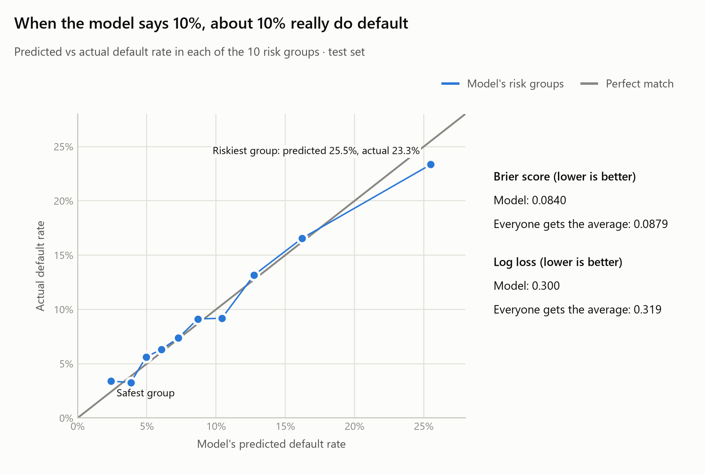

**What it shows:** for each of the 10 risk groups, the model's *predicted* default rate
vs what *actually* happened. The grey diagonal is a perfect match.

**How to read it:** good looks like the dots hugging the diagonal, and ours mostly do. The
riskiest group is a bit too pessimistic (predicted 25.5%, actual 23.4%), and the safest
group slightly too optimistic (2.4% vs 3.4%). The **Brier score** (0.0840) and **log
loss** (0.300) both beat simply giving everyone the average (0.0879 and 0.319).

**Why check this when AUC already looks fine?** AUC only checks the *order*. A model
could sort people perfectly but say "50%" when the truth is 10%. That's fine for picking
who to approve, but very wrong if the bank uses the % itself, say to set interest rates.
Calibration checks the % is believable.

### Flagging the riskiest 10%, 25% or 50%

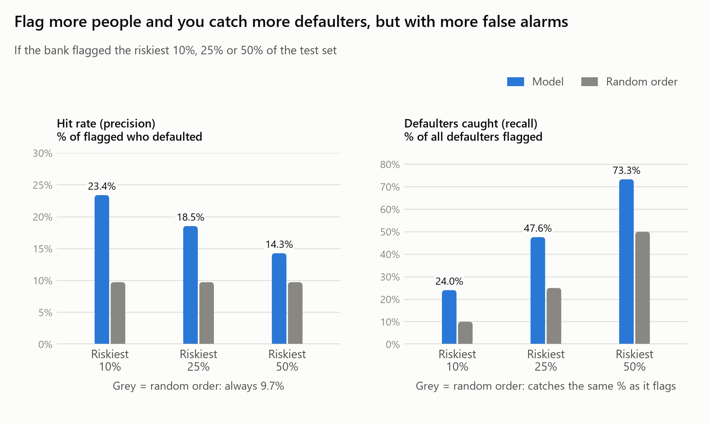

**What it shows:** if the bank flagged a fixed share of the riskiest people, how good
would those flags be?

| Flag the riskiest | Hit rate (precision) | Defaulters caught (recall) | F1 |
|---|---|---|---|
| 10% | 23.4% | 24.0% | 0.237 |
| 25% | 18.5% | 47.6% | 0.267 |
| 50% | 14.3% | 73.3% | 0.239 |

**How to read it:** flag more people and you catch more defaulters (recall goes up), but
more of your flags are false alarms (precision goes down). Random order would always hit
9.7% and catch exactly the share it flags.

**Why this check:** in real life the bank *will* pick a cut-off, and this shows the
trade-off at a few sensible ones. **Why not just F1?** F1 squashes precision and recall
into one number and treats them as equally important. But a missed defaulter (lost money)
and a false alarm (lost customer) don't cost the bank the same, so it's better to see
both.

### Is the model actually worth it?

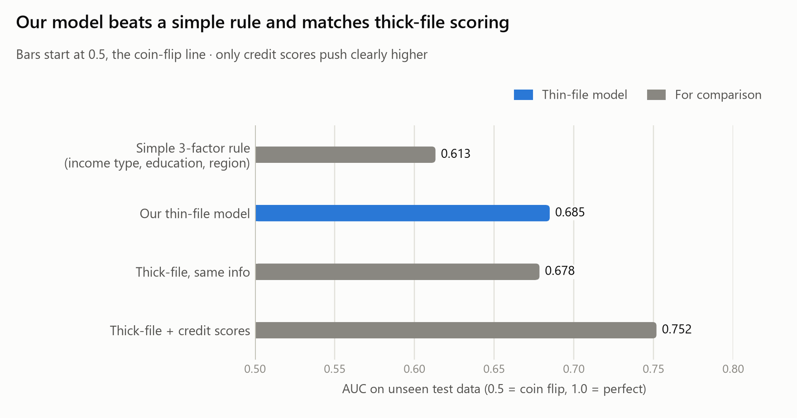

**What it shows:** our model next to three comparisons, all scored the same way:
- a simple 3-factor rule using just income type, education and region: **0.613**
- **our thin-file model: 0.685**
- the same approach on thick-file people with the same info: **0.678**
- thick-file people *plus* credit scores: **0.752**

**How to read it:** longer bars are better (they start at 0.5, the coin-flip line). We
beat the simple rule clearly, so the extra info earns its place. Thin-file people are no
harder to score than thick-file people on the same info. Credit scores add a real boost,
but not having them doesn't leave you blind.

**Why this check:** a model is only worth the effort if it beats something simple. **Why
not just compare against a coin flip?** Beating 0.5 is easy. Beating a sensible rule a
bank could write on a napkin is the real test.

### Does the score hold up if we reshuffle? (stability + overfitting)

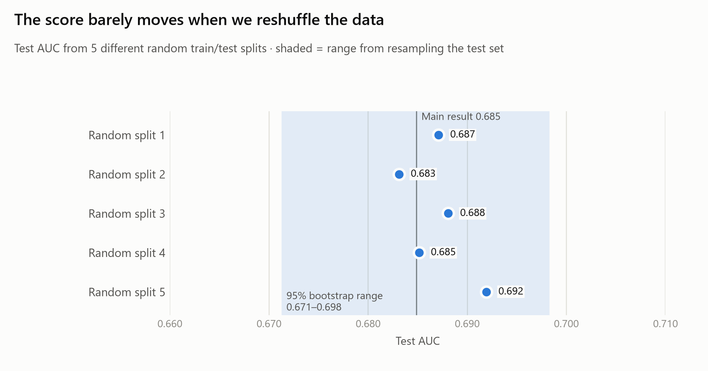

**What it shows:** each dot is the test AUC from a completely different random
train/test split. The shaded band is the 95% range from resampling the main test set
1,000 times (0.671 to 0.698).

**How to read it:** all 5 splits land between 0.683 and 0.692, right around the main
0.685 and well inside the band. So our result isn't a lucky split.

**Why several splits instead of trusting one?** One split could be lucky or unlucky by
chance, and you'd never know. Repeating it shows how much the number wobbles on its own.

Two quick related checks:
- **Overfitting:** the model scores 0.700 on the people it learned from and 0.685 on new
  people. A small drop is normal. A big drop would mean it memorised instead of learned.
- **Leakage:** every previous application was decided before the current one (the
  latest was 1 day before). So the model never peeks at the future.

### Does it work for everyone?

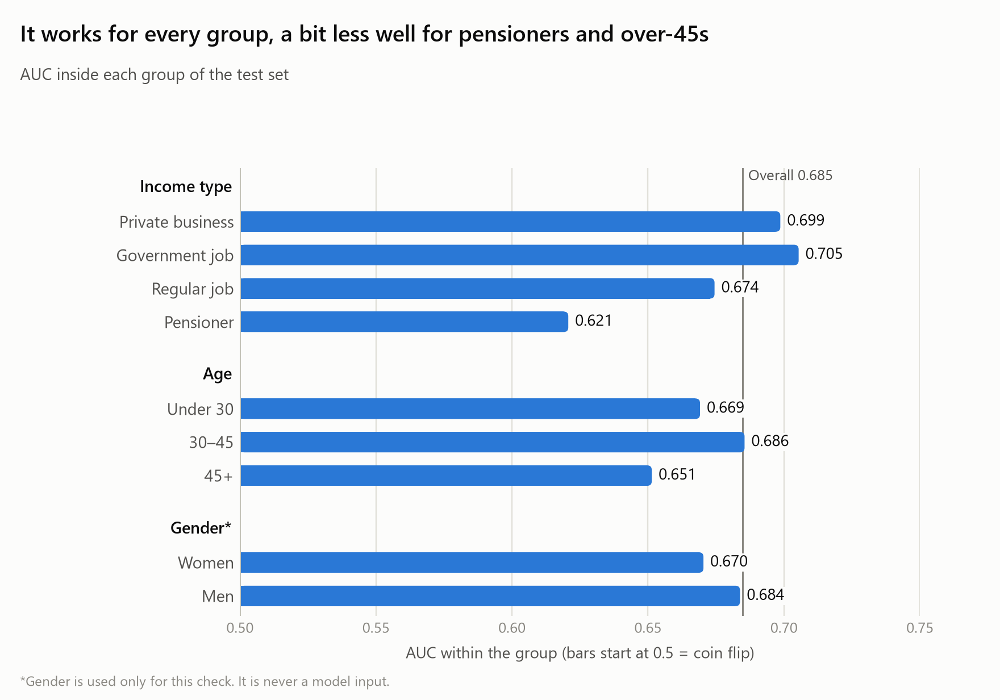

**What it shows:** the AUC calculated *inside* each group: income type, age band and
gender.

**How to read it:** longer bars are better, and the grey line is the overall 0.685.
Every group is well above a coin flip. It's best for private-business and government
workers (about 0.70) and weakest for **pensioners (0.621)** and **people 45+ (0.651)**.
One likely reason: things like job length don't vary much among retired people, so the
model has less to go on.

**Why this check:** a good overall score can hide a group where the model barely works.
**Why not just trust the overall AUC?** Because the bank makes decisions about real
groups of people, not about "on average".

### Fairness: who would actually get approved?

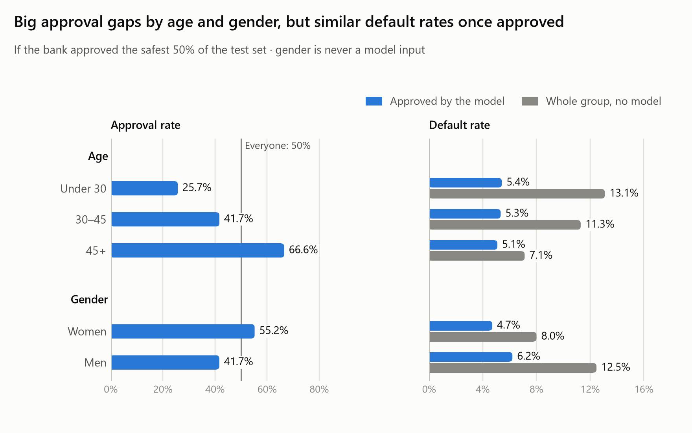

**What it shows:** if the bank approved the safest 50% of the test set, the share of each
group that gets approved, and how often the approved people go on to default.

| Group | Approved | Default rate of those approved | Group's overall default rate |
|---|---|---|---|
| Under 30 | 25.7% | 5.42% | 13.09% |
| 30–45 | 41.7% | 5.34% | 11.30% |
| 45+ | 66.6% | 5.09% | 7.12% |
| Women | 55.2% | 4.71% | 8.01% |
| Men | 41.7% | 6.21% | 12.48% |

**How to read it:** the left panel is how many from each group get approved (the grey
line is the 50% overall). The right panel compares the default rate of the approved
people (blue) with the whole group's default rate (grey). There are **big approval
gaps**. Under-30s get approved 25.7% of the time vs 66.6% for 45+, and men 41.7% vs women
55.2%. But the people who *do* get approved default at similar rates (about 5–6%)
whatever their group. So the model is applying roughly the same risk bar to everyone. The
gaps come from the groups having different default rates to start with.

**The tricky part:** gender is **never** an input, but the model still approves men less
often. That's because other inputs, like job type, income type or owning a car, can act
as **stand-ins (proxies)** for gender. Age *is* a direct input. "The model never saw
gender" does not mean "the model is fair on gender".

**This needs a proper legal/fairness review before any real use.** Lending laws in many
countries look at the *outcome* (who gets approved), not just which inputs you used.

**Why this check:** a model can be accurate overall and still treat some groups very
differently. **Why not just leave gender out and call it fair?** Because, as above,
leaving an input out doesn't stop the model from picking up the same pattern through
other inputs. You have to look at who actually gets approved.

### What drives the score

The four biggest drivers are in the "What mattered most" chart in the Model section
above, along with which way they push risk:
- **Loan much bigger than the price of the goods:** 14% default vs 7–8%
- **Pensioners:** 6% vs 12% for people with a regular job
- **University degree:** 6% vs 11% for secondary school
- **Best-rated region:** 6% vs 14% for the worst

### Tests I *can't* do with this data

- **Out-of-time testing.** The best test is training on older applicants and testing on
  newer ones, because that's how a model is used in real life. This dataset only has
  "days before the application", no real dates, so there's no way to know who applied
  when.
- **The "only approved people have outcomes" problem (reject inference).** We only know
  whether someone defaulted if they *got* a loan. People the bank rejected never get an
  outcome, so we can't check how the model would do on them, and that's exactly the
  group a thin-file model is meant to help.
- **A profit test.** There are no loan profit or loss figures, so I can't say whether
  approving the safest 50% would actually make the bank more *money*, only that it would
  lower defaults.
- **Monitoring after launch.** A real model gets watched for months to make sure it keeps
  working as customers change. There's no live data here to do that.

## Findings

Run on the full `application_train` population (307,511 applicants), joined against `bureau`:

| segment | applicants | share | defaults | default rate |
|---|---|---|---|---|
| thin-file | 68,367 | 22.2% | 6,654 | 9.73% |
| thick-file | 239,144 | 77.8% | 18,171 | 7.60% |
| overall | 307,511 | 100.0% | 24,825 | 8.07% |

Thin-file applicants — those with 0-1 bureau records and at least one missing `EXT_SOURCE`
score — default at **1.28x** the thick-file rate (9.73% vs 7.60%), and make up 22.2% of the
book. This is the population a conventional scorecard is effectively blind to: it isn't just
under-documented, it's measurably riskier. Reproduce with `python src/segment.py` after
building the database (step 2 below).

They also earn less (median $135,000 vs $157,500) and are slightly more often retired
(20.2% vs 17.4%) — but are essentially the **same age** as thick-file applicants, and are
**fully documented on every non-bureau dimension checked**: asset ownership, family status,
contact info, employment tenure, and 93.5% have prior application history with this same
lender. The gap is narrow and specific — bureau depth and external credit scores — not a
general data problem. Full analysis, including every cleaning decision and the
alternatives ruled out along the way, in [reports/segment_findings.md](reports/segment_findings.md).

## Project layout

```
creditbridge-ai/
├── src/
│   ├── config.py, data.py    # paths; raw data loading and the one fixed 80/20 split
│   ├── load_to_duckdb.py     # CSV -> DuckDB
│   ├── clean.py              # cleaning for the descriptive work -> application_train_clean
│   ├── segment.py            # thin/thick-file flagging + segment stats
│   ├── compare_segments.py   # thin- vs thick-file comparison
│   ├── export_dashboard.py   # -> dashboard_export.csv for Power BI
│   ├── pipeline.py           # leak-free preparation pipeline (Part 1 and 2 models)
│   ├── costs.py, cv.py       # error costs, cut-offs; the shared 5-fold CV design
│   ├── prep_experiments.py   # which preparation choices matter (flags, SMOTE leak, ...)
│   ├── compare_models.py     # fair comparison: LR, tree, LDA, SVM, gradient boosting
│   ├── scorecard.py          # lasso path, 5-field scorecard, odds ratios, reasons()
│   ├── evaluate.py           # cost-based cut-off, final model, the one-time test, fairness
│   ├── clusters.py           # k-means applicant segments
│   ├── model_thin_file.py    # Part 2: thin-file model, no bureau data
│   ├── validate_model.py     # Part 2: evaluation + stress tests
│   ├── make_charts.py        # Part 2 charts
│   └── style.py              # shared chart style
├── app/app.py                # Streamlit decision app
├── tests/                    # 98 pytest tests, made-up data only
├── .github/workflows/        # CI: ruff + pytest on every push
├── notebooks/01_data_quality.ipynb
├── reports/                  # write-ups, result tables (CSV/JSON) and figures/
├── dashboards/dashboard_overview.png
├── data/                     # raw/ and processed/ - git-ignored (Kaggle rules)
├── AI_USAGE.md, LICENSE, requirements.txt, requirements-dev.txt, ruff.toml
└── README.md
```

## Setup

```bash
python -m venv .venv
.venv\Scripts\activate          # Windows
pip install -r requirements.txt -r requirements-dev.txt
```

### 1. Get the data

Download `application_train.csv`, `bureau.csv`, and `previous_application.csv` from
[Home Credit Default Risk](https://www.kaggle.com/competitions/home-credit-default-risk/data)
(requires a Kaggle account and accepting the competition rules) and place them in `data/raw/`.

**Do not commit these files.** Kaggle's competition rules permit academic / educational /
non-commercial use of the data but prohibit redistributing it — `.gitignore` excludes
`data/raw/` and every `.csv` under `data/` for exactly this reason. Never push them to a
public repo.

### 2. Build the database

```bash
python src/load_to_duckdb.py
```

Creates `data/processed/creditbridge.duckdb` with tables `application_train`, `bureau`, and
`previous_application`.

### 3. Run the data-quality pass (optional but recommended first)

```bash
jupyter nbconvert --to notebook --execute --inplace notebooks/01_data_quality.ipynb
```

Audits every feature in `application_train` — % missing, skewness, and IQR-flagged
outliers for numeric columns; cardinality and % missing for categorical ones — before any
cleaning decision is made. The findings from this pass drive every decision in step 4.

### 4. Clean the data

```bash
python src/clean.py
```

Creates `application_train_clean` (used for the segments and the dashboard; the models use the
leak-free pipeline instead): median imputation for numeric columns, an explicit
`'Missing'` category for categorical ones, IQR-detected outliers capped at the 1st/99th
percentile, `EXT_SOURCE_1/2/3` missingness preserved (not imputed) as a signal, and the
`DAYS_EMPLOYED` sentinel value resolved. Every decision, including the alternatives
considered and rejected, is written up in [reports/segment_findings.md](reports/segment_findings.md).

### 5. Segment applicants

```bash
python src/segment.py
```

Writes the `applicant_segments` table and prints the size and default rate of each segment.

### 6. Compare segments on the cleaned data

```bash
python src/compare_segments.py
```

Compares thin-file vs thick-file on income, employment length, age, application channel,
and which non-bureau features remain fully populated for thin-file applicants. Full
write-up in [reports/segment_findings.md](reports/segment_findings.md).

### 7. Export the dashboard-ready dataset

```bash
python src/export_dashboard.py
```

Writes `data/processed/dashboard_export.csv` (307,511 rows) with business-readable column
names — `file_type`, `defaulted`, `income`, `employment_years`, `age`, `family_status`,
plus five non-bureau features (`owns_car`, `owns_realty`, `income_type`,
`household_size`, `prior_applicant`) chosen from the fully-populated set identified in
[reports/segment_findings.md](reports/segment_findings.md) §4.

### 8. Power BI dashboard

Built on `data/processed/dashboard_export.csv`, saved as `dashboards/credit_risk_dashboard.pbix`.
Not tracked in git (see `.gitignore` — it embeds a full copy of the exported data in its
internal model, same reasoning as the CSV/DuckDB files). When editing the report, use
**File → Import locale = English (United States)** in Power BI Desktop's app-level
Options and Settings — the source CSV uses `.` as the decimal separator, and a mismatched
locale silently corrupts decimal columns (e.g. `employment_years`) on import.

### 9. Train the thin-file model

```bash
python src/model_thin_file.py
```

Trains on thin-file applicants using only non-bureau information, compares a logistic
regression with gradient boosting, and prints the test results plus a thick-file
benchmark. Takes a minute or two.

### 10. Run the validation checks

```bash
python src/validate_model.py
```

Prints every evaluation number used in "How Good Is the Model, Really?" below.

### 11. Draw the charts

```bash
python src/make_charts.py
```

Re-draws all 12 charts in `reports/figures/` from the data and the model.

### 12. Part 1: the decision model

```bash
python src/prep_experiments.py   # preparation comparisons (~10 min)
python src/compare_models.py     # fair model comparison, out-of-fold predictions (~10 min)
python src/scorecard.py          # lasso path and the 5-field scorecard
python src/evaluate.py           # cost-based cut-off, final model, the one-time test
python src/clusters.py           # applicant segments
```

Results land in `reports/` (CSV/JSON) and `reports/figures/`. The fixed train/test split,
out-of-fold predictions and fitted models go to `data/processed/` (git-ignored).

### 13. The app

```bash
streamlit run app/app.py
```

## Tests

```bash
pytest -q
ruff check src tests app
```

98 tests, none of which need the downloaded data (they use small made-up applicants), so
they also run on GitHub Actions on every push. They cover:
- **no leakage:** a value that exists only in the test rows can't move a learned cap or
  median; the fixed rules never touch protected columns
- the data-quality rules (365243 code, car-age placeholders, the three column-drop rules)
- the cost maths (hand-checked examples, the 1/(1+ratio) cut-off, confusion counts)
- the scorecard's reasons: they add up to the model's log-odds, and "missing" labels
  follow the applicant's own value
- segmentation boundaries, cleaning decisions, the thin-file model's input rules (no
  bureau data, credit score, gender or marital status), and the evaluation helpers

## Limitations and next steps

- **"Default" here means early payment trouble** (Home Credit's label: late on one of the
  first instalments), not a final loss.
- **The 5 : 1 cost ratio is an assumption**; results hold from 3 : 1 to 10 : 1, but a real
  lender would plug in its own numbers.
- **No dates in the data**, so no out-of-time test, and no outcomes for rejected
  applicants (reject inference).
- **The fairness check is not a legal review.**
- Next: monitoring for drift over time, and a profit-based cut-off using real loan margins.

## AI Usage Declaration

I used **Claude Code** (an AI coding assistant made by Anthropic) as an assistant in this
project. The research question, the choice of dataset, the analysis plan and all final
decisions are my own. I wrote every prompt, reviewed every output, and checked the
results before accepting them. The tool mainly helped with writing code, drafting
documentation and charts, and handling routine tasks. That gave me more time to
brainstorm, ask analytical questions and explore the data in more depth. Where the tool
suggested an approach, I evaluated it and decided whether to use it. Version 2 (the leak-free pipeline, Part 1 and the app) brings in methods from my
data-mining course; I approved the upgrade plan and reviewed the result. A full breakdown is
in [AI_USAGE.md](AI_USAGE.md).
